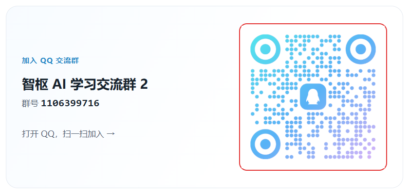

# Codex / Claude Code 国内一键配置教程

Windows / Mac 都能用。登录 → 装客户端 → 一键配置 → 发消息验证，三步用上 Codex、Claude Code、DeepSeek、Grok。

不想点按钮、想自己改配置文件，每篇教程后面都有手动配置的写法，以及常见报错的处理办法。

> 一键配置由 [智枢](https://zhishuhub.com/?aff=zbD0) 提供：不用手填密钥，配置码 30 分钟内有效、只能用一次，按量计费。

## 选你要用的客户端

| 客户端 | 模型 | 教程 |
|---|---|---|
| Codex | ChatGPT（GPT-6、GPT-5.6 等） | [Codex 一键配置](docs/codex.md) |
| Claude Code | Claude（Opus、Sonnet、Fable、Haiku） | [Claude Code 一键配置](docs/claude-code.md) |
| DeepSeek Harness | DeepSeek | [DeepSeek 一键配置](docs/deepseek.md) |
| grok-app | Grok | [Grok 一键配置](docs/grok.md) |

配好以后想让 Codex 生图、做 PPT，看 [Skill 一键安装](docs/skills.md)。

## 三步上手

### 1. 登录并选择客户端

[打开智枢并登录](https://zhishuhub.com/sign-up?aff=zbD0)，没有账号先注册，确认账户余额充足。

[打开安装配置向导](https://zhishuhub.com/guide?aff=zbD0)，选择要用的模型和电脑系统。

### 2. 安装客户端（已有可跳过）

在向导里点「还没有，去下载」，下载对应系统的安装包。装好后打开一次，等初始化完成，再完全退出。

### 3. 一键配置

在向导里点「已经装好，下一步」。

- **Windows**：点「下载配置工具」，双击运行，等窗口提示配置完成。
- **Mac**：点「生成命令」→「复制命令」，打开「终端」粘贴并回车。

### 4. 发消息验证

重新打开客户端，新建对话，发一句「你好，请用中文回复」。收到正常回复就配好了。

## 常见问题

**已经装了客户端，还要重新下载吗？**
不用。直接跳过安装，进入一键配置。

**提示配置码过期或已使用？**
配置码 30 分钟内有效，只能用一次。先打开客户端试一下；还没配好的话，回网站重新生成工具或命令。

**配置后没有回复？**
先看账户余额，再完全退出客户端、重新打开并新建对话。还不行就把报错发到下面的 QQ 群，不要公开密钥或完整的配置命令。

各客户端特有的问题，见对应教程最后一节。

## 加入交流群

智枢 AI 学习交流群 2，群号 **1106399716**，[点击直接加群](https://qm.qq.com/q/UXdEAUEFCC)。

