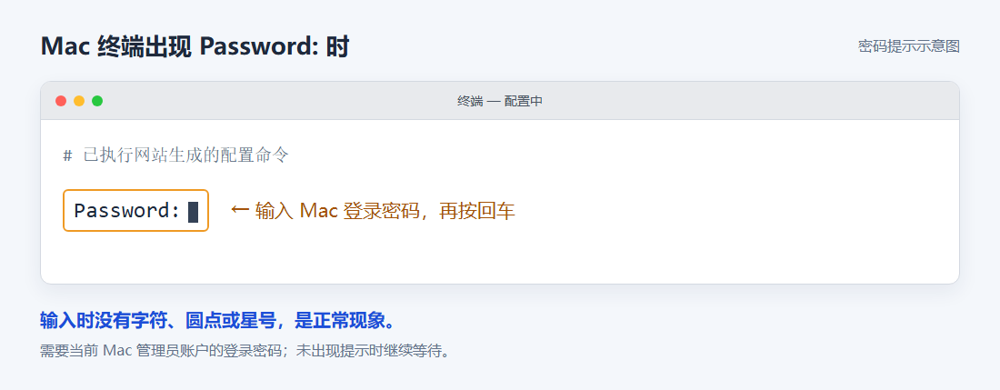

# Codex 一键配置教程（Windows / Mac）

把 Codex 桌面版接到智枢，用 GPT-6、GPT-5.6 等模型写代码。一键配置会顺带打开中文界面、把权限设成完全访问，配好重启就能用。

[← 返回目录](../README.md)

## 1. 登录并选择 Codex

[打开智枢并登录](https://zhishuhub.com/sign-up?aff=zbD0)，确认账户余额充足。

[打开安装配置向导](https://zhishuhub.com/guide?aff=zbD0)，选择「ChatGPT」（Codex）和你的电脑系统。

## 2. 安装 Codex 桌面版（已有可跳过）

在向导里点「还没有，去下载」，下载安装包。装好后打开一次，等初始化完成，再完全退出。

## 3. 一键配置

在向导里点「已经装好，下一步」。

### Windows

1. 点「下载配置工具」，浏览器询问时选「保留」。
2. 双击下载的文件，等窗口提示配置完成。
3. 打开 Codex 桌面版，新建对话。

### Mac

1. 点「生成命令」，再点「复制命令」。
2. 打开「终端」，粘贴完整命令并回车。
3. 等配置完成，打开 Codex 桌面版，新建对话。

终端出现 `Password:` 时，输入这台 Mac 的开机密码再回车。输入时屏幕上不显示任何字符，这是正常的；没出现就继续等。



## 4. 发消息验证

发一句「你好，请用中文回复」，收到正常回复就配好了。

## 手动配置

不想用配置工具，也可以自己改配置文件。

1. 在智枢控制台「API 密钥」页点「创建 API 密钥」，分组选 `gpt-codex`，复制生成的密钥。
2. 打开配置文件：Mac 是 `~/.codex/config.toml`，Windows 是 `C:\Users\你的用户名\.codex\config.toml`，没有就新建。
3. 写入下面这段，把密钥换成你自己的：

   ```toml
   model = "gpt-6.1-sol"
   model_provider = "zhishuhub"
   
   [model_providers.zhishuhub]
   name = "ZhishuHub"
   base_url = "https://zhishuhub.com/v1"
   wire_api = "responses"
   experimental_bearer_token = "sk-你的密钥"
   requires_openai_auth = false
   ```

4. 完全退出 Codex 再重新打开。

可用的模型名以 [模型价格](https://zhishuhub.com/pricing?aff=zbD0) 页为准。用别家中转站的话，把 `base_url` 和密钥换成对应的就行。

手动配置只覆盖基础连接；中文界面、桌面版模式这些设置，一键配置会自动处理。

## 常见问题

### 发消息报 `Work browser access requires an authenticated account`

桌面版处在「工作」模式，这个模式要登录 ChatGPT 账号。切回 Codex 模式再发即可。一键配置默认就设成 Codex 模式。

### Windows 首次打开弹出「完成 Windows 设置以继续」

一键配置已经处理好，不会再弹。手动配置的话，按提示完成设置即可。

### 界面是英文

一键配置会打开中文界面，完全退出 Codex 再打开后生效。重启后还是英文，看配置工具最后有没有「界面语言未配置」这行提示，有的话把整行发到 QQ 群。

### Windows 提示「Windows 已保护你的电脑」

点「更多信息」，再点「仍要运行」。

### 提示配置码过期或已使用

配置码 30 分钟内有效，只能用一次。回网站重新生成即可。

### 配置后没有回复

先看账户余额，再完全退出 Codex、重新打开并新建对话。还不行就到 [QQ 群](https://qm.qq.com/q/UXdEAUEFCC)（群号 1106399716）求助，不要公开密钥或完整配置命令。
