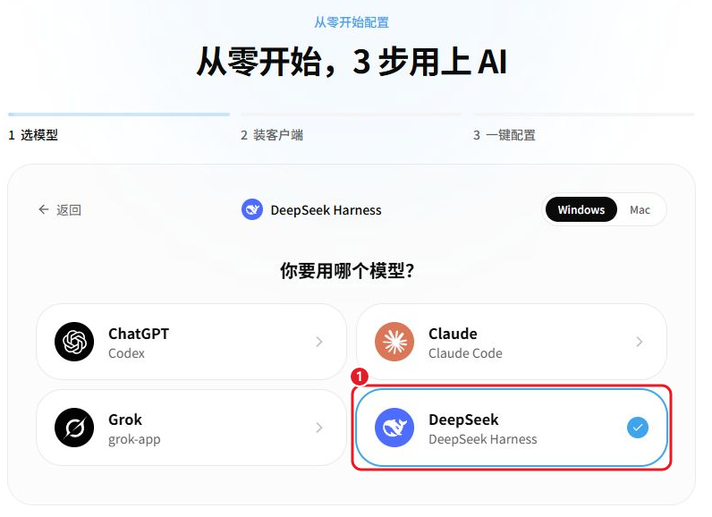
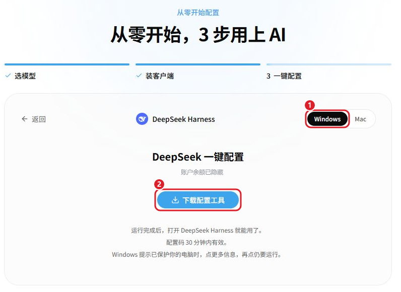
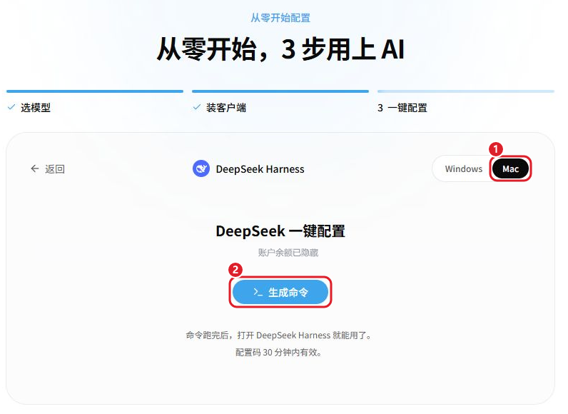

# DeepSeek 一键配置教程（Windows / Mac）

把 DeepSeek Harness 桌面版接到智枢，不用手填密钥，配好重启就能用。

[← 返回目录](../README.md)

## 1. 登录并选择 DeepSeek

[打开智枢并登录](https://zhishuhub.com/sign-up?aff=zbD0)，确认账户余额充足。

[打开安装配置向导](https://zhishuhub.com/guide?aff=zbD0)，选择「DeepSeek」（DeepSeek Harness）和你的电脑系统。

## 2. 安装 DeepSeek Harness（已有可跳过）

### Windows（x64）

1. 在向导里选 Windows，点「还没有，去下载」，下载后运行安装包。
2. 打开 DeepSeek Harness，等初始化完成，再完全退出。

### Mac

1. 在向导里选 Mac，下载安装包，打开 .dmg，把应用拖进「应用程序」。
2. 打开一次，等初始化完成，再完全退出。

## 3. 一键配置

在向导里点「已经装好，下一步」。

### Windows

1. 点「下载配置工具」，浏览器询问时选「保留」。
2. 双击运行，按窗口提示操作，等提示配置完成。
3. 完全退出 DeepSeek Harness，再重新打开并新建对话。

### Mac

1. 点「生成命令」，再点「复制命令」。
2. 打开「终端」，粘贴完整命令并回车。
3. 等配置完成，重新打开 DeepSeek Harness 并新建对话。

配置工具只添加「智枢」这一个提供方，DeepSeek Harness 里原有的其他提供方和登录信息都保留，改动前会先备份。

## 4. 发消息验证

发一句「你好，请用中文回复」。收到正常回复后，回到向导点「已收到回复，完成配置」。

## 常见问题

### Mac 上提示「请先安装 DeepSeek Harness 并打开一次」

DeepSeek Harness 要装在「应用程序」里，并且至少打开过一次，再重新运行命令。

### Windows 提示「Windows 已保护你的电脑」

点「更多信息」，再点「仍要运行」。

### 提示配置码过期或已使用

配置码 30 分钟内有效，只能用一次。先打开客户端试一下；还没配好的话，回网站重新生成工具或命令。

### 配置后没有回复

先看账户余额，再完全退出 DeepSeek Harness、重新打开并新建对话。还不行就到 [QQ 群](https://qm.qq.com/q/UXdEAUEFCC)（群号 1106399716）求助，不要公开密钥或完整配置命令。
