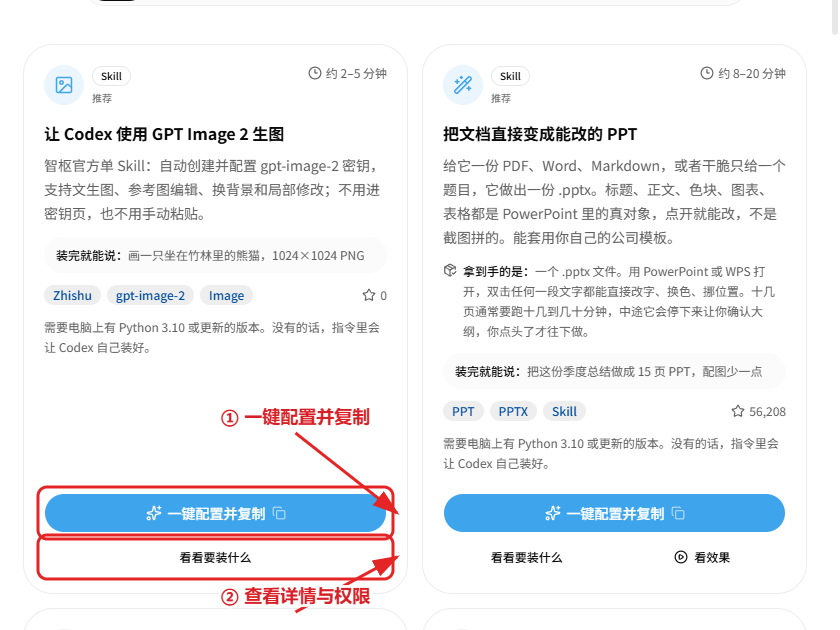
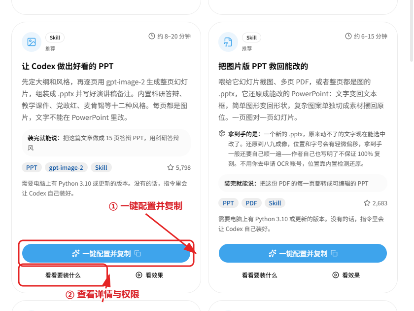

# Codex Skill 一键安装：生图、做 PPT

让 Codex 用 GPT Image 2 生图、把文章做成 PPT、把文档变成能改的 PPT。Skill 免费，模型调用按网站计费。

先完成 [Codex 一键配置](codex.md)，再装 Skill。

[← 返回目录](../README.md)

## 1. 打开技能广场

[打开智枢技能广场](https://zhishuhub.com/skills?aff=zbD0)，找到需要的能力。装之前可以点「看看要装什么」查看详情和权限。

## 2. 复制安装指令

### 生图

找到「让 Codex 使用 GPT Image 2 生图」，点「一键配置并复制」。

### PPT（图片版）

找到「让 Codex 做出好看的 PPT」，点「一键配置并复制」。

需要能直接改字的 PPT，选「把文档直接变成能改的 PPT」。

## 3. 交给 Codex 安装

在 Codex 里新建对话，粘贴安装指令并发送，按提示完成安装。安装指令里带有专用密钥，不要转发给别人。

## 4. 新会话试用

按提示重启 Codex 或新建会话，再试一次：

- 生图：「画一只竹林里的熊猫」
- PPT：「把这篇文章做成 15 页答辩 PPT」

## 常见问题

### 提示缺少 Python、Node 或 uv

让 Codex 按提示安装即可。

### 想移除某个 Skill 或 MCP

在技能广场点「看看要装什么」，详情里写了移除方法。
